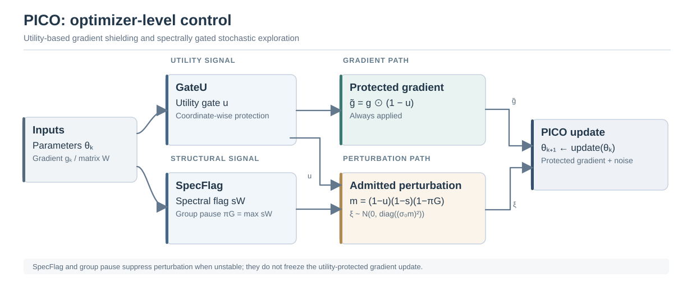

# Plasticity without Collapse: Plasticity-Inducing Control Optimizer for Cross-Lingual Continual Pre-Training

<p align="center">
  <a href="https://aclanthology.org/2026.emnlp-main.528/"></a>
  <a href="https://aclanthology.org/2026.emnlp-main.528/"></a>
  <a href="LICENSE"></a>
</p>

<p align="center">
  Sumin Kim · Minjun Song · Surin Lee · S M Wahidur Rahman · Yongtae Lee · Haeung Choi · Heung-No Lee<br>
  Gwangju Institute of Science and Technology (GIST)
</p>

<p align="center">
  <a href="https://aclanthology.org/2026.emnlp-main.528/">Paper</a> ·
  <a href="https://aclanthology.org/2026.emnlp-main.528.pdf">PDF</a> ·
  <a href="TRAINING.md">Reproduction Guide</a>
</p>

This repository contains the official implementation of **PICO (Plasticity-Inducing Control Optimizer)**, presented at **EMNLP 2026 (Main Conference)**. PICO addresses catastrophic forgetting during continual pre-training (CPT) across languages and domains by controlling parameter updates and stochastic exploration at the optimizer level, without requiring replay or architectural modifications.

## Overview

Continual pre-training must accommodate new data while retaining previously learned capabilities. PICO integrates three coordinated controls:

- **GateU:** attenuates the gradient in high-utility parameter coordinates.
- **SpecFlag:** periodically monitors leading singular-value and spectral-concentration changes to detect structural sensitivity.
- **Group pause:** propagates matrix-level spectral warnings across an optimizer parameter group, suppressing perturbations.

The protected gradient remains active when structural warning flags disable the stochastic perturbation path.

<p align="center">
  
</p>
<p align="center"><em>Figure 1. PICO combines a utility-protected gradient with stochastic perturbations admitted by coordinate-, matrix-, and group-level controls.</em></p>

For utility gate `u`, structural flag `s`, and group pause `π`, the core control is

```text
Protected gradient: g̃ = g ⊙ (1 − u)
Perturbation mask:  m = (1 − u) ⊙ (1 − s) ⊙ (1 − π)
Noise:              ξ ~ N(0, diag((σ₀ m)²))
```

SpecFlag and group pause operate on the *noise path*, not as an update freeze. Refer to the paper for the complete update rule and the spectral-check implementation.

## Worst Collapse Ratio (WCR)

We introduce **Worst Collapse Ratio (WCR)** to expose the largest relative degradation of an individual learned domain, which can be masked by averaged continual-learning scores:

```text
R*i = max{R[t,i] : t = i, ..., T}
WCR = max_i (1 − R[T,i] / R*i)
```

Here, `R[t,i]` denotes a non-negative, higher-is-better evaluation score on domain `i` after stage `t`; `R*i` is the best post-learning score for that domain. **Lower is better.** WCR complements forward transfer (FWT), backward transfer (BWT), and average forgetting (AvgF). It is not directly defined for lower-is-better scores such as perplexity.

## Installation

```bash
git clone https://github.com/infonet-gist/infonet-ai-pico.git
cd infonet-ai-pico
python -m venv .venv
source .venv/bin/activate
pip install -r requirements.txt
accelerate config
```

Select **MULTI_GPU (DDP)** when configuring Accelerate. The repository rejects FSDP in its training launcher because flattened parameter views would disable matrix-level spectral monitoring. Check hardware requirements and all configuration details in [TRAINING.md](TRAINING.md).

## Quick Start

### Optimizer usage

```python
from cp4llm.optimizer.PICO import PICO

optimizer = PICO(
    model.parameters(),
    lr=2e-5,
    weight_decay=0.01,
    beta_utility=0.999,
    sigma=0.001,
    spectral_update_freq=1,
    power_iterations=1,
)

for batch in dataloader:
    loss = model(**batch).loss
    loss.backward()
    optimizer.step()
    optimizer.zero_grad()
```

### Reproducing continual pre-training

The four-stage stream is **Korean Medical → English Medical → Korean Legal → English Legal**. Obtain access to the required model and corpora and set the corresponding environment variables. In particular, the Korean Medical data must be obtained directly from AI Hub and provided locally:

```bash
export HF_TOKEN=<your_huggingface_token>
export KOR_MEDICAL_PATH=/path/to/assembled_korean_medical_corpus.txt

# One method, one seed (training + evaluation)
SEEDS="777" bash scripts/run_all.sh pico

# Main script defaults to seeds 777, 911 and 4041
bash scripts/run_all.sh pico

# Baseline comparison
bash scripts/run_all.sh all
```

Without `KOR_MEDICAL_PATH`, the launcher warns and skips the Korean Medical stage; such a **three-stage run does not reproduce the four-stage paper setting**. Detailed dataset setup, conditions, and hyperparameters are documented in [TRAINING.md](TRAINING.md).

### Model scale and evaluation

```bash
MODEL_SIZE=3b bash scripts/run_all.sh pico
MODEL_SIZE=8b bash scripts/run_all.sh pico

# Evaluate existing checkpoints without retraining
bash scripts/run_all.sh --eval-only pico
```

`MODEL_SIZE` supports `1b` (Llama-3.2-1B-Instruct), `3b` (Llama-3.2-3B-Instruct), and `8b` (Llama-3.1-8B-Instruct). The 8B launcher uses a single process with a balanced device map; smaller models use DDP. The repository uses `σ₀ = 0.001` and `f = 1` by default. For other configurations, refer to the source scripts and [TRAINING.md](TRAINING.md).

Evaluation includes **ROUGE-L, BLEU, METEOR, cosine similarity, and Token F1**, with additional diagnostic scores. Continual-learning summaries include **FWT, BWT, AvgF, and WCR**. GSM8K is an evaluation-only out-of-domain probe, not a CPT training stage.

## Repository Structure

```text
.
├── cp4llm/
│   ├── optimizer/PICO.py      # PICO optimizer
│   ├── train_cpt.py          # CPT training entry point
│   ├── train/                # Shared training and baseline methods
│   ├── eval/                 # Generation and continual-learning evaluation
│   └── utils/                # Dataset and training utilities
├── scripts/
│   ├── env.sh                # Shared model, data and experiment settings
│   ├── train.sh              # Training launcher
│   ├── eval.sh               # Evaluation launcher
│   └── run_all.sh            # Training + evaluation
├── assets/pico-method.svg    # PICO method overview
├── TRAINING.md               # Full reproduction guide
└── requirements.txt
```

## Data and Reproducibility

The study evaluates cross-lingual CPT in legal and medical domains. Corpus access and redistribution are governed by the upstream data providers. **Corpus text is not included in this repository**; in particular, the Korean Medical materials from AI Hub datasets 71487 and 110 cannot be redistributed here. See [TRAINING.md](TRAINING.md) and the paper's data appendix for dataset provenance, usage conditions, and experiment details.

PICO's reported behavior is specific to the tested model scales, language/domain curricula, and evaluation protocols. The supplementary experiments in the paper should not be assumed to be reproduced by every default repository command.

## Citation

If you find this repository useful, please cite our EMNLP 2026 paper:

```bibtex
@inproceedings{kim2026plasticity,
  title={Plasticity without Collapse: Plasticity-Inducing Control Optimizer for Cross-Lingual Continual Pre-Training},
  author={Kim, Sumin and Song, Minjun and Lee, Surin and Rahman, SM Wahidur and Lee, Yongtae and Choi, Haeung and Lee, Heung-No},
  booktitle={Proceedings of the 2026 Conference on Empirical Methods in Natural Language Processing},
  pages={12174--12203},
  year={2026}
}
```

[Published paper in the ACL Anthology](https://aclanthology.org/2026.emnlp-main.528/).

## License

The code is released under the [MIT License](LICENSE). Dataset licenses and access restrictions remain those of their respective upstream providers.
